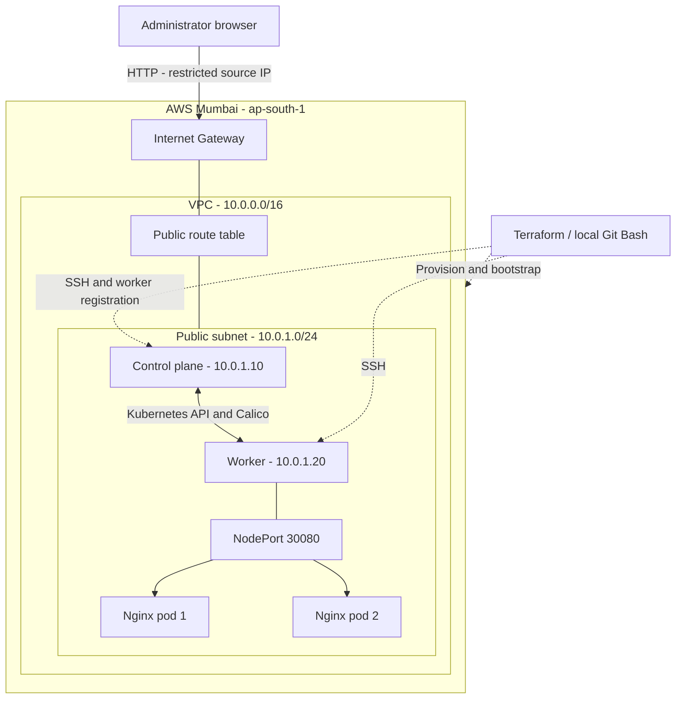

# Self-Managed Kubernetes on AWS with Terraform

   

## Overview

A hands-on infrastructure automation project that provisions a self-managed Kubernetes cluster on AWS EC2 without Amazon EKS. Terraform provisions networking and compute, EC2 user data bootstraps Kubernetes, and a Terraform-managed local-exec workflow registers worker nodes using dynamically generated bootstrap tokens.

The cluster was validated with a two-replica Nginx deployment exposed through a NodePort service.

## Architecture



## Technology stack

| Layer | Technology |
|---|---|
| Cloud | AWS EC2, VPC, subnet, Internet Gateway, route tables, security groups, EBS |
| Infrastructure as code | Terraform, AWS provider |
| Operating system | Amazon Linux 2023 |
| Compute | m7i-flex.large, one control plane and one worker |
| Kubernetes | kubeadm, kubelet, kubectl; tested with v1.34.13 |
| Container runtime | containerd |
| Networking | Calico CNI, CoreDNS, kube-proxy |
| Automation | Bash, cloud-init, Terraform local-exec |
| Validation workload | Nginx Alpine, two replicas, NodePort |

## Network design

| Parameter | Value |
|---|---|
| Region | ap-south-1 |
| Availability zone | ap-south-1a |
| VPC CIDR | 10.0.0.0/16 |
| Public subnet | 10.0.1.0/24 |
| Control plane private IP | 10.0.1.10 |
| First worker private IP | 10.0.1.20 |
| Pod CIDR | 192.168.0.0/16 |
| Service CIDR | 10.96.0.0/12 |
| Kubernetes API | TCP 6443 |
| Demo NodePort | TCP 30080 |

## Repository structure

```text
.
├── data.tf                    # Amazon Linux AMI lookup
├── main.tf                    # AWS networking and EC2 resources
├── join.tf                    # Terraform-driven worker registration
├── outputs.tf                 # Infrastructure outputs
├── provider.tf                # AWS provider configuration
├── variables.tf               # Input variables
├── versions.tf                # Terraform and provider requirements
├── terraform.tfvars.example   # Example configuration
├── .terraform.lock.hcl         # Provider dependency lock
├── .gitignore
├── scripts/
│   ├── common.sh              # Runtime and Kubernetes prerequisites
│   ├── control-plane.sh       # kubeadm init and Calico installation
│   ├── worker-node.sh         # Worker bootstrap
│   └── join-worker.sh         # Dynamic token and SSH registration
├── screenshots/
└── README.md
```

## Automation workflow

1. Terraform creates a custom VPC, public subnet, Internet Gateway, route table and separate security groups.
2. Terraform discovers an Amazon Linux 2023 AMI and provisions EC2 instances with encrypted root volumes and IMDSv2.
3. Cloud-init runs the common bootstrap script on both nodes: kernel modules, sysctl settings, swap configuration, containerd and Kubernetes packages.
4. The control-plane script initializes Kubernetes, configures kubectl and installs Calico.
5. `terraform_data.worker_join` runs a local Bash script after provisioning. It waits for cloud-init, generates a 15-minute bootstrap token and joins each worker through SSH.
6. The cluster is validated using kubectl and an Nginx workload.

Worker count is configurable through Terraform. Worker addresses are calculated using `cidrhost`, and instance ID changes trigger registration again. This is configurable provisioning, not Kubernetes cluster autoscaling.

## Deployment instructions

### Prerequisites

- AWS account and configured AWS CLI credentials with permissions to provision the resources.
- Terraform 1.6 or later, Git, Bash and OpenSSH.
- Existing EC2 key pair in the target region and its local private key.
- Current public IPv4 address for restricted SSH and demo access.
- Verify SSH host keys before trusting new hosts; the registration script requires trusted SSH connectivity.

### 1. Clone and configure

```bash
git clone https://github.com/vangitirahul/terraform-self-managed-kubernetes-aws.git
cd terraform-self-managed-kubernetes-aws
cp terraform.tfvars.example terraform.tfvars
```

Edit `terraform.tfvars` with your region, existing key pair, local PEM path, public IP in CIDR notation and desired worker count. Keep the subnet and control-plane address consistent with the bootstrap scripts.

### 2. Provision

```bash
terraform init
terraform fmt -check
terraform validate
terraform plan
terraform apply
```

Review the plan before approval. Terraform may replace instances when bootstrap user data changes. On a fresh deployment, SSH host-key prompts or connectivity failures may require manual verification before retrying the registration resource.

### 3. Verify Kubernetes

```bash
terraform output master_public_ip
terraform output worker_public_ips
ssh -i /path/to/key.pem ec2-user@MASTER_PUBLIC_IP
```

On the control plane:

```bash
sudo cloud-init status --wait
kubectl get nodes -o wide
kubectl get pods -A
```

Wait for both nodes to become Ready and system pods to become Running.

### 4. Deploy and expose Nginx

On the control plane:

```bash
kubectl create deployment nginx --image=nginx:alpine --replicas=2
kubectl rollout status deployment/nginx
kubectl create service nodeport nginx --tcp=80:80 --node-port=30080
kubectl get deployments
kubectl get pods -o wide
kubectl get svc
```

Ensure the Terraform worker security group permits TCP 30080 from your public IP only. Open `http://WORKER_PUBLIC_IP:30080` in your browser.

### 5. Optional self-healing test

```bash
kubectl delete pod <nginx-pod-name>
kubectl get pods -w
```

The Deployment controller should create a replacement pod to restore two replicas. Press Ctrl+C to stop watching.

## Implementation evidence

### AWS infrastructure

Both Kubernetes EC2 instances passed all three EC2 status checks.


### Terraform provisioning


### Kubernetes workload and networking

The Nginx Deployment reported two available replicas. Both application pods were Running on the worker, and the system pods shown were Running with zero restarts.


### Application accessibility


## Security practices

- Separate control-plane and worker security groups; restrict SSH and demo NodePort ingress to the administrator's IP.
- Encrypted EBS root volumes and mandatory IMDSv2.
- Dynamically generated short-lived join tokens instead of hardcoded tokens in Terraform configuration.
- Exclude private keys, Terraform state and actual tfvars from version control.
- Review screenshots and logs for secrets before publication. Public IPs and resource identifiers are operational metadata; redact them if unnecessary.

## Troubleshooting

| Symptom | Diagnostic or action |
|---|---|
| SSH connection fails | Check current source IP, security group, key path and verified host key |
| Bootstrap fails | `sudo tail -100 /var/log/cloud-init-output.log` |
| Node NotReady | `kubectl describe node NODE_NAME`; check containerd and Calico |
| Worker join fails | Check cloud-init, API connectivity, token expiry and existing kubeadm state |
| Nginx unreachable | Check pods, service endpoints, NodePort ingress and worker public IP |
| Terraform plans replacement | Review AMI changes and user-data changes before applying |

## Limitations and future improvements

This is a learning-grade implementation, not a production-ready or highly available cluster. Both nodes are in one availability zone and have public IPs. Internal security group rules are broad. Registration depends on local SSH access; retrying a partially completed join or replacing the control plane while retaining workers requires additional lifecycle handling. The latest AMI and package selection may change over time. Application deployment is performed with kubectl, not Terraform.

Future improvements include private subnets, least-privilege internal networking, multi-AZ highly available control planes, pinned versions, remote encrypted Terraform state, idempotent node registration, monitoring and declarative application manifests.

## Cleanup (optional)

AWS resources incur charges while running. When finished with the cluster, review and approve cleanup:

```bash
terraform plan -destroy
terraform destroy
```

Do not run cleanup while the cluster is still needed.

## Skills demonstrated

AWS networking and compute provisioning, Terraform resource dependencies and dynamic infrastructure, Linux bootstrap automation, Kubernetes cluster administration, container runtime configuration, CNI networking, workload scheduling and service exposure.

## Author

[GitHub — vangitirahul](https://github.com/vangitirahul)
